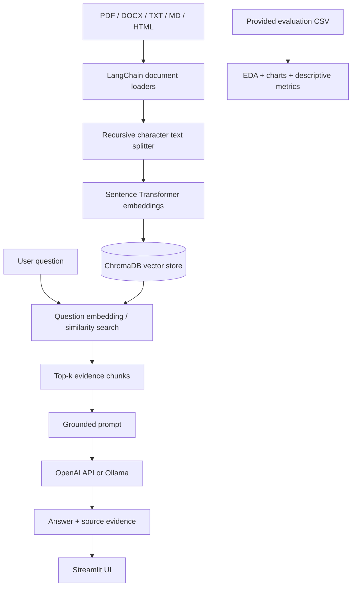

# System Architecture

## Block diagram

## Trust and safety design
- The system prompt instructs the model to answer only from retrieved context and to admit when evidence is missing.
- Source filename, page/section and chunk ID are surfaced beside answers.
- A relevance threshold prevents generation when no retrieved chunk meets the baseline threshold; this threshold requires validation.
- Uploaded document contents are treated as data, not instructions.
- API keys are entered through Streamlit's password input and are not written to project files.

## Dataset boundary
The supplied CSV includes metadata and pre-recorded scores only. The actual content for live retrieval must come from uploaded documents. Evaluation metrics from the CSV must not be represented as newly measured performance of the live application.
